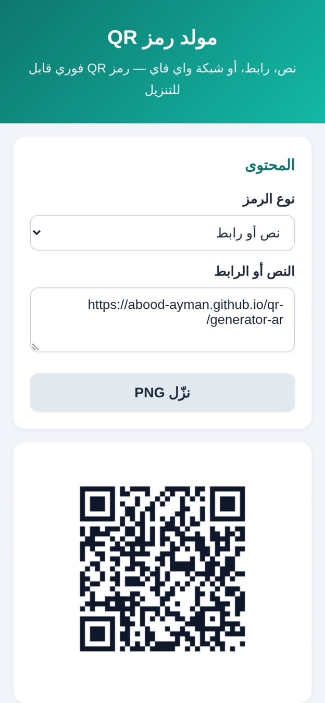

# QR Code Generator | مولد رمز QR

Turn any text, link, phone number or WiFi credentials into a QR code and download it as PNG or SVG. Arabic interface.

**Live app:** https://abood-ayman.github.io/qr-generator-ar/

**LinkedIn:** [Project entry](https://www.linkedin.com/in/abdullah-ayman-1678b737b/details/projects/)

This is a personal project, built with AI tools.

## Features
- QR for any text, link or phone number
- Ready-made WiFi pattern (name and password) to share with guests
- Download the code as a high-quality PNG
- Generation happens only in your browser, so your data (and passwords) never leave your device

## Note
Uses the open-source qrcode-generator library (MIT), inlined in the page.

## Privacy
Everything runs in your browser. No data is stored or sent anywhere.

## Run locally
Open `index.html` in any browser. It is a single static page with no dependencies.

## Status
Stable.

## Copyright
MIT License - Copyright (c) 2026 Abdullah Ayman.
